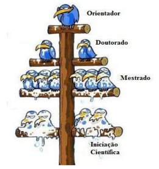

# Permanência Estudantil

> Permanecer na universidade também é dinheiro, pesquisa, estágio e saúde.
> Valor e edital mudam. Este capítulo te aponta o caminho; o site oficial
> fecha o número.

## Bolsas Sociais: o documento que prova a vida

Permanência na universidade é também financeira. Existem auxílios — social
(BAS, ~R$ 857–904/mês com 10 horas semanais), moradia (BAM), alimentação
(BITA), transporte (BAT) e estudo-formação (BAEF) — via SAE e coordenadorias.
O montante? Em 2026, mais de R$ 211 milhões distribuídos entre 5.611 alunos.
A grana existe.

Agora, o lado chato: valor muda de ano pra ano, faixa de renda per capita
aperta, e além de entrevista tem visita na tua casa pra confirmar que você
está de verdade precisando. Não dá pra blefar pobreza com o SAE. Mas o gesto
não muda — você oferece documento e a universidade acredita ou não. Rápido
assim.

**IMPORTANTE:** Atraso na inscrição é atraso que custa. Edital vigente do ano fecha o número oficial.

**MACETE!** Monta inscrição no edital do ano, não em PDF antigo de grupo que
circula no Zap. Edital vigente fecha o número. Em dúvida, liga pro SAE ou
pergunta pro veterano do teu curso que já passou.

Consulta a página oficial de bolsas (SAE, [sae.unicamp.br](https://www.sae.unicamp.br/))
na semana que o edital sai.

## PIBIC, FAPESP e Bolsa de Extensão: o cardápio de pesquisa

Além da permanência social, tem bolsa de **pesquisa** e de **extensão**.
O pacote muda o quanto você pode acumular com estágio — escolha cedo,
porque depois fica apertado. E sim, quanto mais dinheiro entra, mais
responsabilidade, quase sempre.

### PIBIC

Bolsa de iniciação científica, CNPq ou institucional. O ritmo? Relaxado na
comparação. **Acumula com estágio**: dá pra manter as duas frentes se o
horário fechar e você não usar dorminhoco demais pra entender que 8h da
manhã é 8h mesmo. É a porta clássica pra pesquisa sem te engolir a semana inteira.

### FAPESP

Bolsa mais robusta, com escopo e cobrança que não brinca. **Não acumula com
estágio**. Você fica dedicado à pesquisa: mais hora, mais entrega, menos
espaço pra um contrato paralelo. Entra se topa esse ritmo — trabalho pesado
de verdade. FAPESP pede mais página e mais projeto; o valor acompanha a cobrança.

### Bolsa de Extensão

Costuma **acumular** com outras coisas e, no que a galera conta, paga mais
que a PIBIC — quando aparece. A vaga é rara: precisa de sorte e estar no
projeto certo na hora certa. Fica de olho em edital e em quem já está em
extensão; rena da fila de espera é bem conhecida.

> PIBIC e estágio, em geral, convivem. FAPESP é pesquisa em tempo quase
> integral. Extensão bem paga existe, e é rara. O edital do ano manda na
> combinação.

## Estágio Cedo: o Músculo que Treina Resposta

Procura estágio o mais cedo que der. Se você é tímido, melhor ainda começar
já: entrevista, organização, extensão, qualquer coisa que te force a falar,
apresentar e treinar resposta pra quando o processo seletivo real chegar.
Porque vai chegar. Quando a pergunta clássica vier — "fale de um projeto que
você participou" — ela já está na ponta da língua, não presa na garganta
como primeira vez.

Tem gente que descobre estágio no terceiro ano e acha que o histórico
inexistente não conta. Conta. Muito.

→ Manda um currículo curto e atualiza a cada semestre.
→ Entra em algo que te faça treinar — organização, extensão, monitoria — antes do processo seletivo.
→ Recusa faz parte. O músculo é tentar de novo.

## Duplo diploma

### Macete

★ Se quer **duplo diploma**, começa cedo. O cronograma só aperta com o tempo.
★ Entrou na **1ª ou 2ª chamada**? Dá pra tentar alterar a matrícula e já incluir matéria do segundo curso no primeiro semestre. Fazer duas graduações ao mesmo tempo é pra poucos, e quanto mais cedo, menos impossível.
★ A demanda em matérias de **TADS e BSI** anda alta; coordenação costuma barrar. Depende muito de quem está na coordenação no teu semestre.
★ Mantém o **CR alto**. Ele é critério de desempate quando você disputa disciplina extracurricular ou vaga apertada.

Confirma regra e vaga com a coordenação do curso. Este macete não
substitui o “pode” oficial do semestre.

## SAE, SAPPE e Saúde: o Tripé que Segura

Permanência também é acolhimento. Saúde mental e psicologia ficam com SAPPE
— a universidade mantém atendimento pra quem precisa arrancar o peso de
dentro. O CECOM, na FT, resolve o agudo leve — dor de garganta, gripe,
mal-estar — de segunda a sexta, 7h às 19h. Não espere raio-X ou ressonância
ali; osso quebrado e emergência pesada vão pro **HES (Hospital Estadual de
Sumaré)** ou pra **FOP (Faculdade de Odontologia de Piracicaba)** se for
dente. Vacinação e encaminhamentos também passam por CECOM.

**ALERTA!**
Pedir ajuda não é sinal de fraqueza — é gestão de recurso. A universidade mantém
serviço de psicologia (SAPPE), atendimento de saúde (CECOM) e financeiro (SAE) justamente
pra isso. Carregar tudo sozinho costuma sair mais caro.

Usa cedo, não só quando a coisa já estiver feia.

> Se precisa de atendimento, usa. A universidade que pague.

## Fechamento

Bolsa social: site oficial, documento em dia, edital do ano. Pesquisa:
escolhe o ritmo — PIBIC mais flexível, FAPESP mais devota, extensão se a
vaga aparecer. Estágio e duplo diploma: cedo. Saúde: sem adiar.

- Antes de qualquer inscrição, abre o edital vigente. Este capítulo aponta a porta; o edital diz se ela está aberta.
